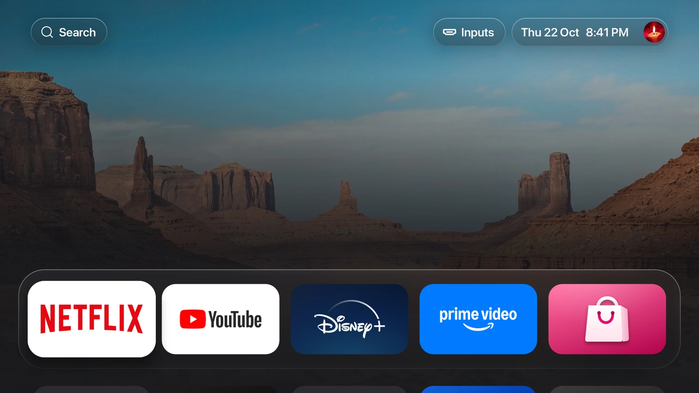
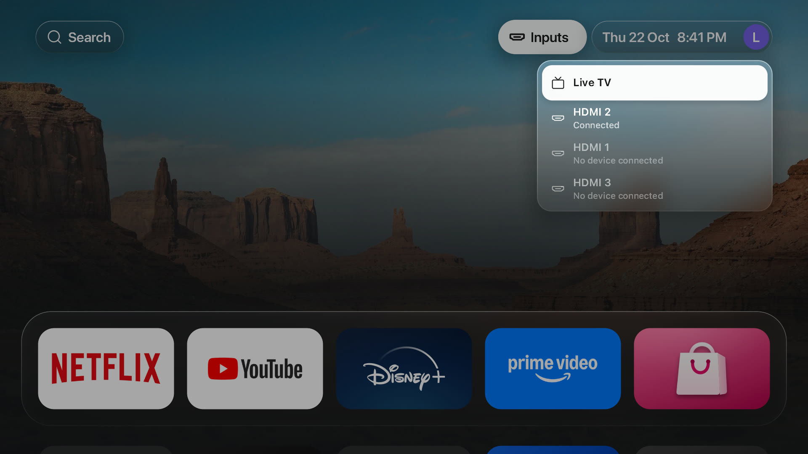
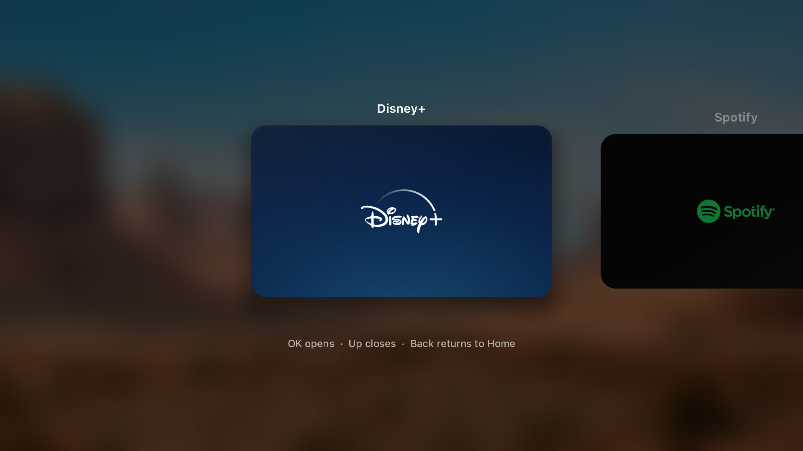
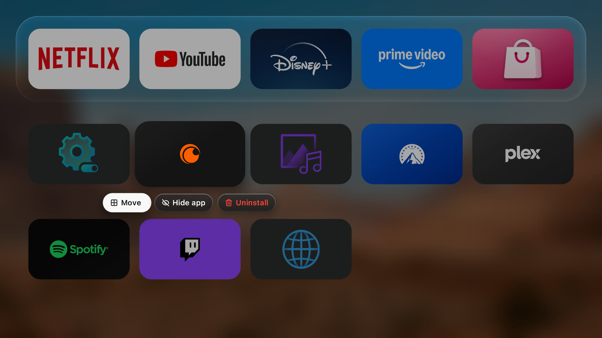
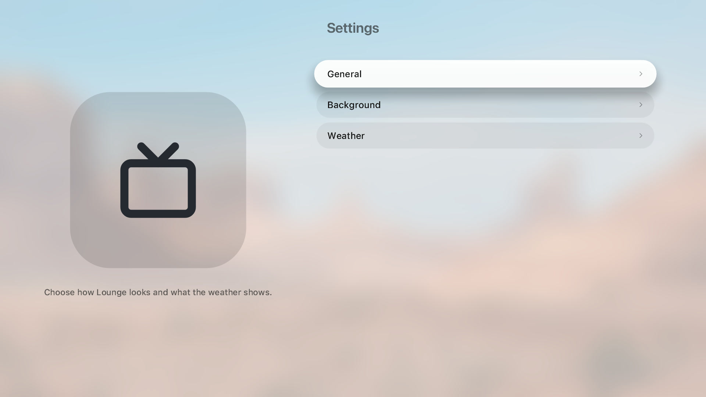
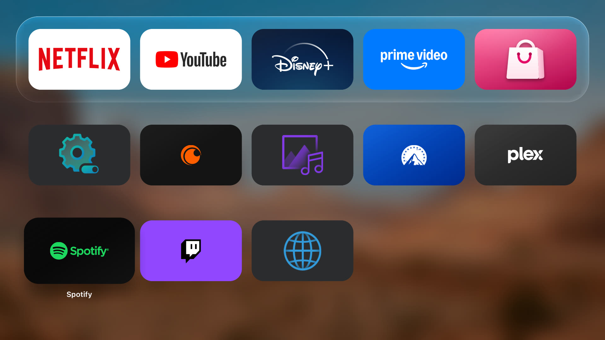
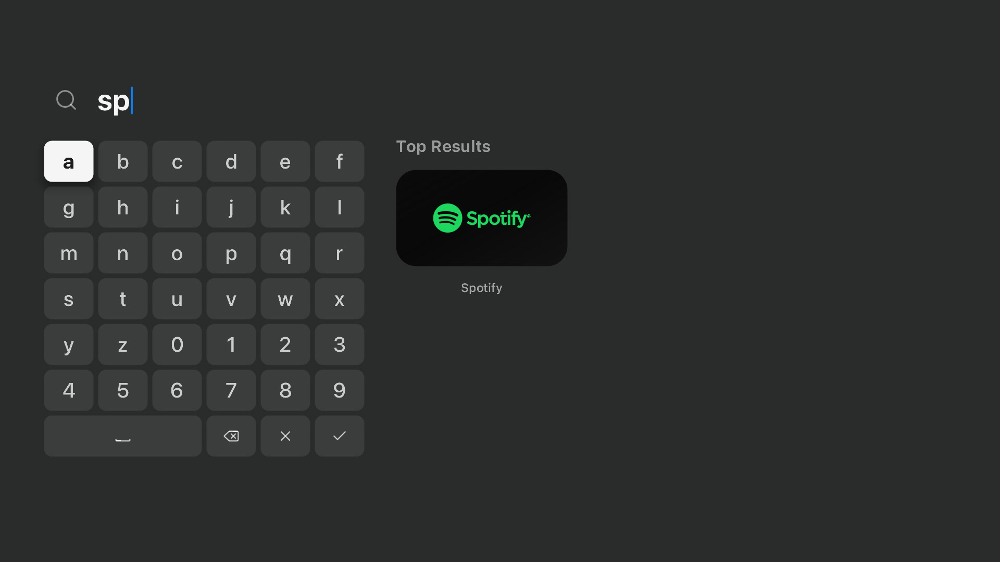

<div align="center">


# Lounge

**A calm, tvOS-style home screen for LG TVs. Native, instant, and out of the way.**

[](https://github.com/YashwanthKamireddi/lounge/actions/workflows/ci.yml)
[](https://github.com/YashwanthKamireddi/lounge/releases/latest)
[](#compatibility)
[](license)

[](development.md)
[](development.md)
[](https://github.com/webosbrew/SDL-webOS)
[](#install)



[Install](#install) · [Features](#features) · [Compatibility](#compatibility) · [Build](#build)

</div>

## Why Lounge

Lounge replaces LG's home screen with one that feels like an Apple TV: a glass dock of your apps,
nothing else competing for attention, and no ads. Measured on an LG 65UQ801C0SB:

|                      |                                                           |
| -------------------- | --------------------------------------------------------- |
| **Behind YouTube**   | holds about 25 MB, against about 113 MB for LG's own Home |
| **Cold start**       | first frame in 0.42 s                                     |
| **Home from an app** | back in about 0.1 s                                       |
| **Sitting on Home**  | wakes about once a minute (for the clock); nothing polls  |

### How it's built

Most home screens for webOS, LG's included, are built on a web engine (Chromium, through LG's
WebAppMgr) or a UI toolkit (Qt/QML) that stays loaded the whole time. Lounge is a single native
binary of about 4.5 MB, written in Rust, that renders straight to the TV's graphics plane with
OpenGL ES 2.0 through SDL2. Everything below follows from that.

- **Rendering.** Each frame is a draw list compiled into batched GL calls. Liquid Glass is one
  fragment shader sampling a pre-blurred backdrop, with lens refraction at the rim, so a glass
  panel costs one pass, and a cross-fade between two backdrops is still one pass. Opaque tiles are
  written to the stencil buffer first, so nothing hidden behind them is shaded. With EGL partial
  update, a frame repaints only the region that changed.
- **Text and icons.** Glyphs and interface icons are vector outlines tessellated into triangle
  meshes (lyon) and drawn on the GPU, sharp at any size, with each laid-out line of text cached.
- **Budgets.** CI renders each screen of the smoke tests headless, and any that goes over 3.25
  screens of fill per frame, 64 MB of artwork or 8 MB of text geometry fails the build.
- **Start-up.** Linked shader programs are cached on the TV (GL_OES_get_program_binary), pictures
  ship ASTC-compressed for the GPU, and decoding and uploads run on worker threads. First frame
  from a cold start: 0.42 s. Nothing on the drawing thread reads a file or waits on the network.
- **Idle and background.** The loop blocks in SDL until something happens. webOS pushes app,
  input and window changes over its Luna bus, and workers wake the loop the moment they finish.
  Idle on Home, it wakes about once a minute for the clock. Behind an app it frees its textures
  and returns memory to the system (about 25 MB resident behind YouTube, against about 113 MB for
  LG's Home).
- **Taking over Home.** Lounge's binary is bind-mounted over LG Home's executable (webOS 5, 6 and 22
  to 24), or a Home manifest pointing at Lounge is mounted (webOS 25 and 26). Either way it registers
  with webOS's app manager, so a Home press brings back the running instance instead of starting
  it again. Nothing is written to LG's firmware. Three failed starts within a minute hand Home back
  to LG, and a plain-shell restore works even if Lounge itself can't run.
- **One build for every TV.** A portable ARMv8 (Cortex-A53, NEON) binary with link-time
  optimisation, and 205 Rust unit tests plus native smoke tests of every screen.

[development.md](development.md) covers each part in depth.

## Features

<table>
  <tr>
    <td width="50%"></td>
    <td width="50%"></td>
  </tr>
  <tr>
    <td width="50%"></td>
    <td width="50%"></td>
  </tr>
  <tr>
    <td width="50%"></td>
    <td width="50%"></td>
  </tr>
</table>

- **Liquid glass everywhere:** dock, menus, alerts and the app switcher share one material, in
  Light, Dark or Automatic.
- **Inputs one press away:** Up from the dock reaches Search and Inputs. Inputs lists Live TV and
  every HDMI port, plugged-in ones first, under LG's own names.
- **Hold OK on any app** to move, hide or uninstall it.
- **An app switcher** for what's open: OK opens, Up closes, Back returns.
- **Search** from a letter grid, with results as you type.
- **For everyone in the room:** a focus outline, larger app names and reduced motion, one switch
  each.

## Install

You need an LG TV rooted with an elevated [Homebrew Channel](https://www.webosbrew.org/).

1. In Homebrew Channel › Settings › Extra repositories, add
   `https://github.com/YashwanthKamireddi/lounge/releases/latest/download/repo.json`
2. Install **Lounge** from Homebrew Channel. Updates arrive there too.
3. Open Lounge and choose **Make Home**. From then on, the Home button opens Lounge.

Prefer a file? Install `io.github.yashwanthkamireddi.lounge_1.2.0_arm.ipk` from
[Releases](https://github.com/YashwanthKamireddi/lounge/releases/latest) with
[webOS Dev Manager](https://github.com/webosbrew/dev-manager-desktop).

**Back to LG's Home, any time, with the remote:** turn off Settings › General › Lounge as Home.
Uninstalling Lounge in Homebrew Channel and restarting the TV does it too. Nothing is written to
LG's firmware, and if Lounge ever fails to start three times in a minute, it hands Home back to LG
by itself. (Over SSH: `sh /var/lib/lounge/home.sh disable`.)

## Compatibility

Lounge runs on every LG TV from 2020 on: webOS 5 and 6, then webOS 22 to 26 (LG names these by
year; internally they are versions 7 to 11). It picks the right way to become Home
for each by itself. It is verified on webOS 22 (version 7.6); the others are covered by tests and
are waiting for reports. If a TV can't have Lounge as its Home, Settings says why: the
Homebrew Channel needs root, another launcher is already Home, or the webOS version isn't
supported yet. Lounge then still opens as an app.

## Known limits

- After a cold start, LG's Home shows for a few seconds before Lounge takes over: webOS starts it
  before any homebrew can run.
- Verified on webOS 22 only so far. Other versions are covered by tests, not yet by real TVs.
- English only for now.

Found a problem or tried it on another TV? [Open an issue](https://github.com/YashwanthKamireddi/lounge/issues).

## Privacy

No telemetry and no accounts. Settings stay on the TV; the only network requests are for the
weather (Open-Meteo, OpenStreetMap). Lounge writes no log files unless you switch diagnostics on
by creating `/var/lib/lounge/debug`. Rooting is your call, and Lounge comes without warranty
(see the [license](license)).

## Build

```sh
nix develop
pnpm install --frozen-lockfile
pnpm sdk
export WEBOS_NDK="$PWD/.build/toolchain/arm-webos-linux-gnueabi_sdk-buildroot"
pnpm run package   # dist/io.github.yashwanthkamireddi.lounge_1.2.0_arm.ipk
pnpm dev           # desktop preview with sample apps
```

[development.md](development.md) covers the architecture, tests, diagnostics and releases.

## Credits

A fork of [lg-luma](https://github.com/ecklf/lg-luma) by ecklf and contributors (MIT, notice kept
in the [license](license)). Not affiliated with LG, Apple or any app brand shown.
