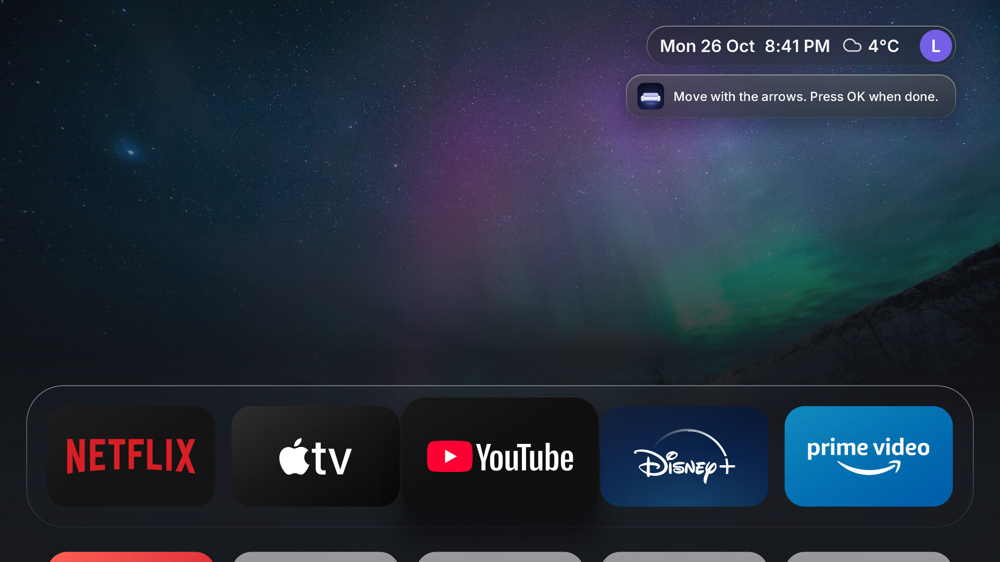
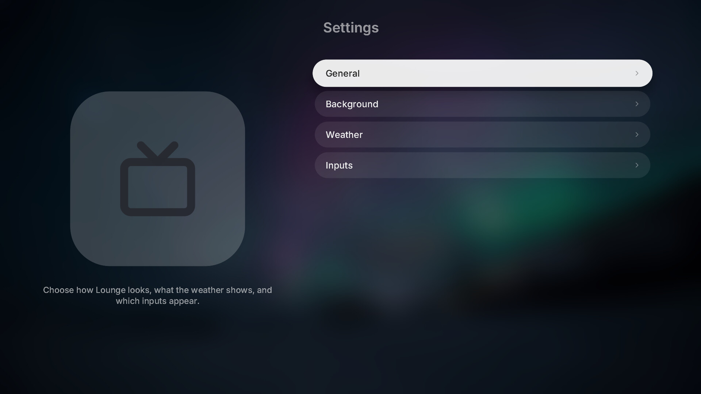
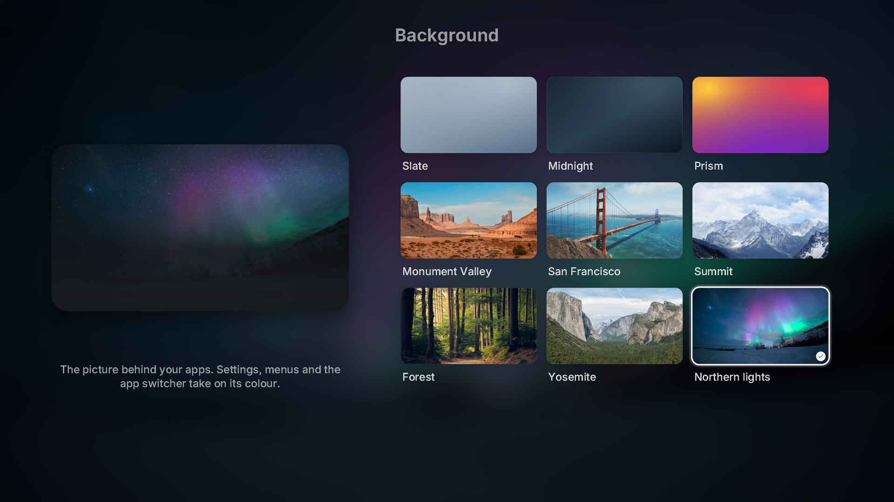
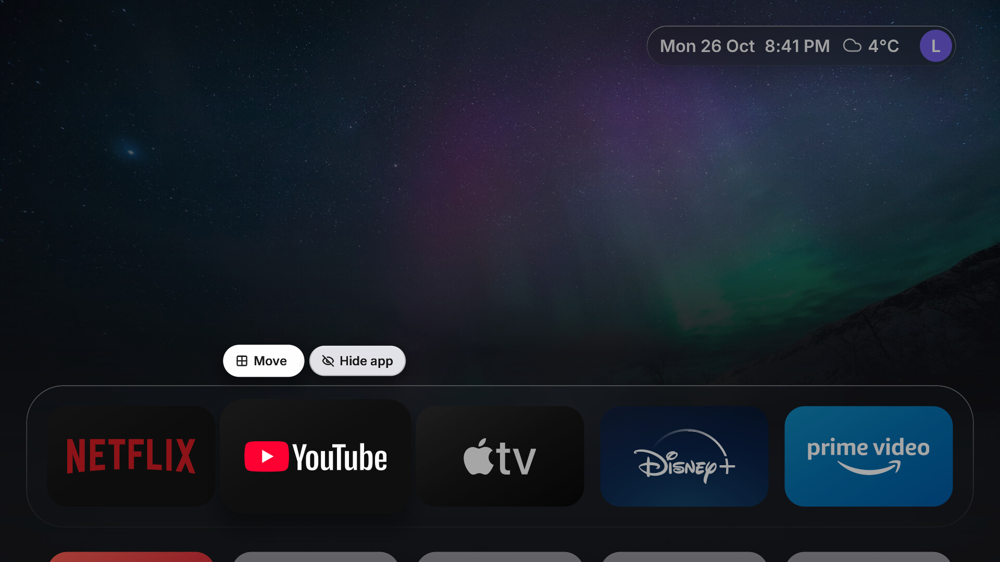
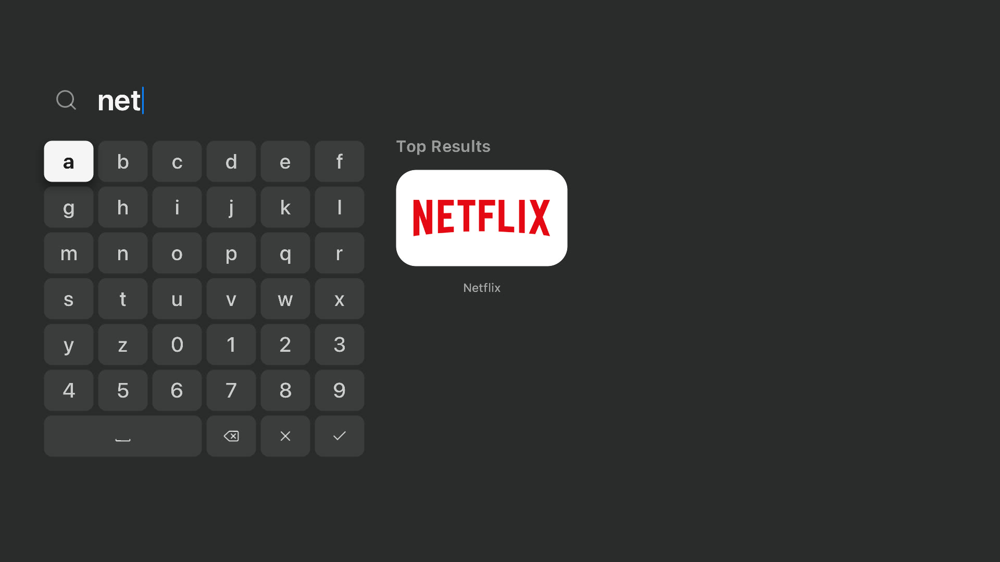

<div align="center">


# Lounge

**A calm, tvOS-style home screen for LG TVs.**<br>
Native, fast and quiet, so the only thing you notice is what you came to watch.

[](https://github.com/YashwanthKamireddi/lounge/actions/workflows/ci.yml)
[](license)
[](#requirements)
[](#how-it-works)

[Features](#features) · [Tour](#a-tour) · [Why Lounge](#how-lounge-differs) · [Install](#install) · [Make it your Home](#make-lounge-your-home) · [Make it yours](#make-it-yours) · [Build](#build-it-yourself)


</div>

## Features

- **A real tvOS home.** A glass dock of favourites over your wallpaper, an app grid that slides
  up beneath it, and your HDMI inputs as tiles.
- **Turns on into Lounge.** Power-on, the remote's Home key and backing out of an app all land on
  Lounge, with no LG Home in between.
- **Smooth on modest hardware.** Built for a one-core TV GPU: it repaints only what changed and
  never stacks full-screen layers, so menus, the switcher and Settings stay fluid.
- **Out of your apps' way.** Behind YouTube, Netflix or any other app it draws nothing and hands
  memory back, so the app you are watching keeps the TV to itself.
- **Yours.** Light, Dark or Automatic appearance, nine wallpapers, a profile picture, hidden apps,
  rearranging, and live weather in the corner.

## A tour

<table>
  <tr>
    <td width="50%"></td>
    <td width="50%"></td>
  </tr>
  <tr>
    <td align="center"><sub><b>Every app and input</b>, one press below the dock</sub></td>
    <td align="center"><sub><b>The app switcher</b>: Back on Home shows what is open</sub></td>
  </tr>
  <tr>
    <td width="50%"></td>
    <td width="50%"></td>
  </tr>
  <tr>
    <td align="center"><sub><b>Hold OK</b> on an app to move or hide it</sub></td>
    <td align="center"><sub><b>Move</b>: the app lifts and slides where you want it</sub></td>
  </tr>
  <tr>
    <td width="50%"></td>
    <td width="50%"></td>
  </tr>
  <tr>
    <td align="center"><sub><b>Settings</b>, tinted by your wallpaper</sub></td>
    <td align="center"><sub><b>Nine wallpapers</b>, each with its own glass</sub></td>
  </tr>
  <tr>
    <td width="50%"></td>
    <td width="50%"></td>
  </tr>
  <tr>
    <td align="center"><sub><b>Light</b>, <b>Dark</b> or <b>Automatic</b> by time of day</sub></td>
    <td align="center"><sub>Menus, banners and search follow the appearance</sub></td>
  </tr>
  <tr>
    <td width="50%"></td>
    <td width="50%" valign="middle">
      <b>Search</b> finds any app as you type, on a one-row keyboard made for the remote.<br><br>
      <sub>Screenshots are the desktop preview, which renders exactly what the TV draws, with
      sample apps.</sub>
    </td>
  </tr>
</table>

## How Lounge differs

Most home-screen replacements for LG TVs are web pages running in the TV's built-in browser.
Lounge is a native program, and it takes over Home with webOS's own settings rather than scripts.

|                      | **Lounge**                                                                                                         | Typical web-page launcher                                          |
| -------------------- | ------------------------------------------------------------------------------------------------------------------ | ------------------------------------------------------------------ |
| Runs as              | Native Rust + OpenGL ES, drawing straight to the screen                                                            | HTML/CSS in LG's browser engine                                    |
| Start-up             | About half a second on a fresh TV                                                                                  | A browser page has to load first                                   |
| Behind a playing app | Draws nothing, hands memory back                                                                                   | The page and its engine stay in memory                             |
| Taking over Home     | LG's default-Home setting and a compositor key filter: no boot scripts of its own, nothing mounted over LG's files | Boot scripts, a mount over LG Home, or a watcher on another device |
| Power-on             | Lands on Lounge, verified with power cycles                                                                        | Varies by launcher                                                 |
| Look                 | tvOS: glass dock, focus lift, a context menu that keeps its app lit                                                | Varies                                                             |

Lounge also keeps itself small on purpose: no screensaver, no video wallpapers, no extra
services. The TV's memory belongs to what you are watching.

## Requirements

- An LG TV running webOS, rooted with the [Homebrew Channel](https://www.webosbrew.org/)
  (elevated). Verified on an **LG 65UQ801C0SB, webOS 7.6**.
- Lounge started as a fork of [lg-luma](https://github.com/ecklf/lg-luma), which reports webOS 6
  and newer. Lounge's own changes (power-on, the Home key, memory behind apps) are tested on
  webOS 7.6 only; reports from other TVs are welcome in
  [Issues](https://github.com/YashwanthKamireddi/lounge/issues).

## Install

[Build the `.ipk`](#build-it-yourself) (ready-made packages will be on
[Releases](https://github.com/YashwanthKamireddi/lounge/releases) from the first release). Then, from
your computer, replacing `TV_IP`:

```sh
scp -O io.github.yashwanthkamireddi.lounge_1.0.0_arm.ipk root@TV_IP:/tmp/lounge.ipk
ssh root@TV_IP
```

In the TV's root shell:

```sh
luna-send -i luna://com.webos.appInstallService/dev/install \
  '{"id":"io.github.yashwanthkamireddi.lounge","ipkUrl":"/tmp/lounge.ipk","subscribe":true}'
```

[webOS Dev Manager](https://github.com/webosbrew/dev-manager-desktop) installs it with a click as
well. Open **Lounge** from the TV's app list.

## Make Lounge your Home

Lounge replaces LG Home through webOS's own mechanisms: nothing runs at boot and nothing is
mounted over LG's files. Verified on webOS 7.6 (UQ80); each step is one setting and undoes
cleanly. Run in the TV's root SSH shell.

**Back out of an app opens Lounge.** webOS opens the app registered as the default Home. On
webOS 7 the setting does not exist until written:

```sh
luna-send -n 1 luna://com.webos.settingsservice/setSystemSettings \
  '{"category":"general","settings":{"defaultApps":{"home":"io.github.yashwanthkamireddi.lounge"}}}'
```

Leaving an app then shows Lounge directly, without LG Home in between. To undo, set
`defaultApps` back to `{}`.

**The Home button opens Lounge.** The remote's Home key is handled by the compositor's key-filter
chain (configd `com.webos.surfacemanager.keyFilters`), loaded at boot. A filter that maps Home to
`io.github.yashwanthkamireddi.lounge`, such as [Glasshouse](https://github.com/rorygallagher2024/glasshouse)'s remote
keys, sends every press straight to Lounge.

**Lounge stays resident, LG Home does not.** LG's memory manager (`memchute`) reads
`/home/root/memorymanager-conf.json` before its built-in `/etc/palm` copy. Adding
`io.github.yashwanthkamireddi.lounge` to `KeepOnLaunchEx`, and taking `com.webos.app.home` out of it, keeps Lounge
loaded behind apps while LG Home is freed when an app opens. Takes effect after a restart; keep a
copy of the original file to undo.

## Make it yours

**Profile picture.** Lounge shows your LG account's initial in the time pill. To use a photo
instead, copy JPEG or PNG files into Lounge's folder on the TV, then choose one in
Settings › General › Profile picture (several can take turns):

```sh
D=/media/developer/io.github.yashwanthkamireddi.lounge
mkdir -p $D/avatars && cp my-photo.jpg $D/avatars/
chown -R $(stat -c %u:%g $D) $D/avatars    # Lounge must own its folder
```

Lounge reads the folder when it starts: quit it from Settings › General and open it again.

**Top Shelf art.** Like tvOS, a picture can fill the screen behind the dock while an app is
focused. LG apps do not provide one, so Lounge ships none: put your own 16:9 images in
`local/heroes/`, named by app ID (`netflix.jpg`, `youtube.leanback.v4.jpg`), and build. The
Top Shelf Art switch appears in Settings › General once any are present.

## How it works

Lounge is a native program, not a web page: Rust on SDL2 and OpenGL ES 2, drawing straight to the
TV's graphics plane. That is what lets it start in about half a second on a fresh TV and stay
light behind your apps.

| Part                             | What it does                                                               |
| -------------------------------- | -------------------------------------------------------------------------- |
| `src/state/`                     | Focus, navigation, the switcher, rearranging and appearance                |
| `src/view/`                      | Turns state into a scene: home, Settings, menus, glass and themes          |
| `src/renderer/`                  | Draws the scene: shaders, textures, vector text, occlusion, partial redraw |
| `src/platform.rs`, `src/luna.rs` | Talks to webOS: apps, inputs, launches, power and lifecycle events         |
| `src/main.rs`                    | The `Shell`: each frame is tick → input → present, then sleep until needed |

Every full-screen effect (dimming, Settings' veil, the switcher's fade) is folded into the one
background pass instead of drawn as another layer, because a TV GPU is limited by how many pixels
it paints per frame.

## Build it yourself

### Setup & Building

From the repository root, with Nix flakes enabled:

```sh
nix develop
pnpm install --frozen-lockfile
pnpm sdk
export WEBOS_NDK="$PWD/.build/toolchain/arm-webos-linux-gnueabi_sdk-buildroot"
pnpm run package
```

The first native runtime preparation also downloads a
checksum-pinned SDL-webOS library; both downloads are cached under `.build/`.

Output:

```text
dist/io.github.yashwanthkamireddi.lounge_1.0.0_arm.ipk
dist/sha256sums
dist/repo.json
dist/app-icon-large.png
```

Open [webOS Dev Manager](https://github.com/webosbrew/dev-manager-desktop), connect to the TV's
IP on port **22** as **root**, and install the IPK. Open **Lounge** from the TV menu. Homebrew
Channel must be elevated.

Wait for installation success; Ctrl+C closes an ongoing subscription. Fully close and reopen
Lounge after updating. The [development guide](development.md#tv-startup-diagnostics) has a jailed
launch command that exposes errors hidden by the normal menu launch.

## Preview

```sh
nix develop
pnpm install --frozen-lockfile
pnpm assets
pnpm dev
```

The desktop preview uses sample inventory and never calls TV services. To manually exercise a
longer app grid:

```sh
pnpm dev --test-extra-apps 120
```

Preview preferences are separate from normal preferences. See [development.md](development.md)
for controls, vector rendering, diagnostics, tests and the source layout.

For release-worthy changes, include a file generated by `pnpm changeset` in your PR. The automated
Version Packages PR synchronizes app versions and publishes after merging and passing CI.
See [Releases](development.md#releases) for the workflow and repository setup.

## Privacy

App/input discovery uses fixed inventory commands through Homebrew Channel's elevated service.
App launches use the native Luna bus with declared permissions. There is no demo inventory
fallback on the TV. Native caller permissions and lifecycle behavior can differ by firmware.

Favorites, hidden apps, settings, weather location and cached readings stay in local JSON files
in an app-owned persistent directory outside the installed payload.
Weather search/forecast requests go to Open-Meteo, with embedded TLS roots and bounded responses.
There is no browser geolocation, IP-based location lookup, telemetry or runtime font download.

## Use at your own risk

Lounge runs on rooted TVs and changes how they start and what the Home key opens. Every change
is one setting that can be undone, and none touches LG's firmware or files, but rooting and
modifying a TV is your decision and your responsibility. Lounge is provided as is, without
warranty of any kind (see the [license](license)); its authors are not liable for any damage to
your TV, loss of data, voided warranty or anything else that comes from installing or using it.

## Credits

Lounge is a fork of [lg-luma](https://github.com/ecklf/lg-luma) by ecklf and its contributors,
under the MIT licence; their copyright notice is kept in [license](license). Thank you.

Lounge is not affiliated with LG, Apple or any app brand shown in its UI.
