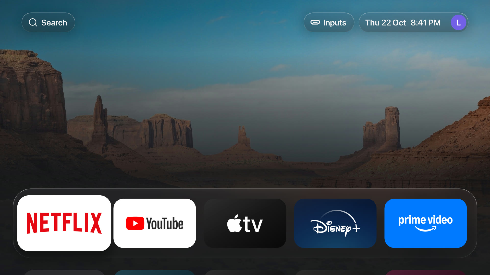
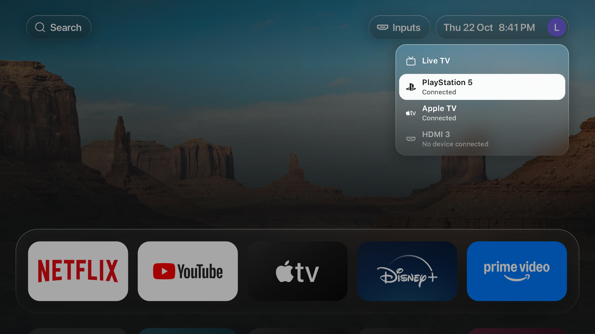
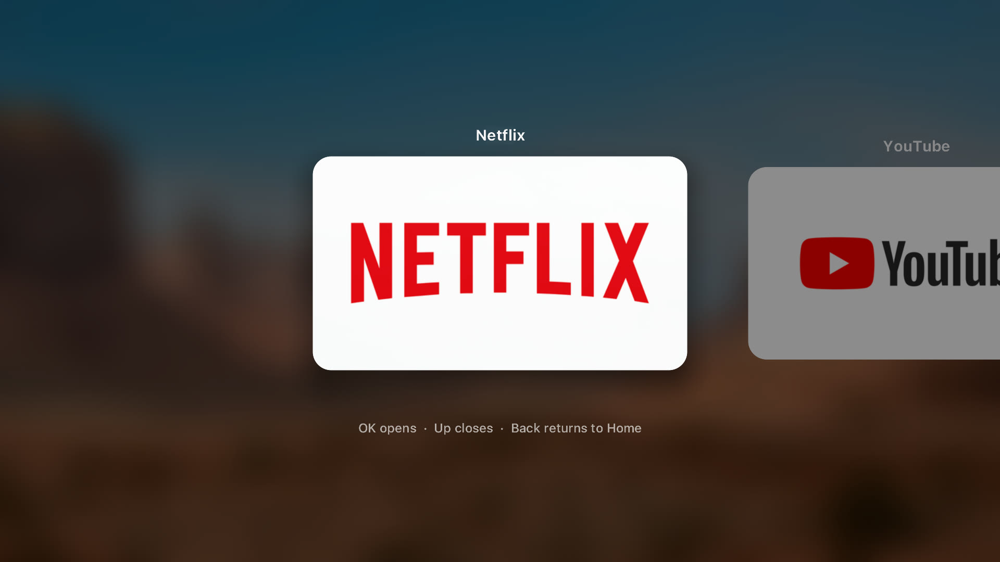
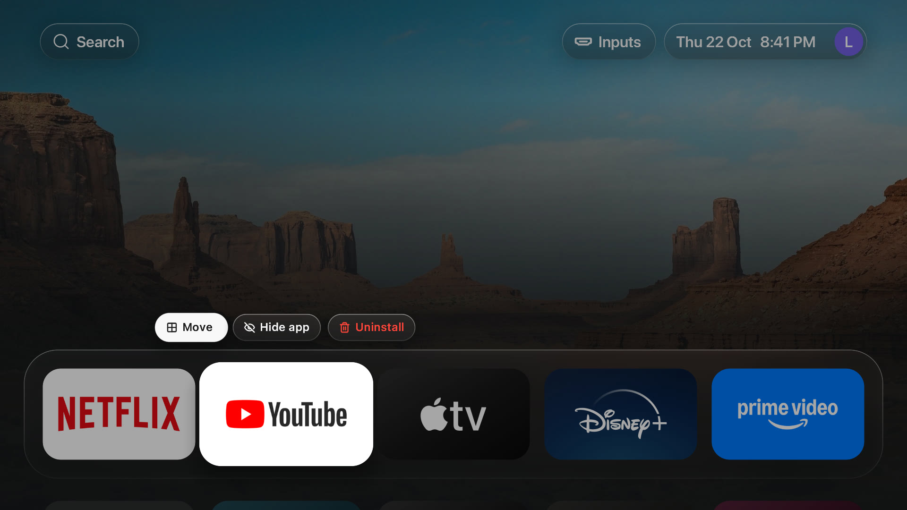
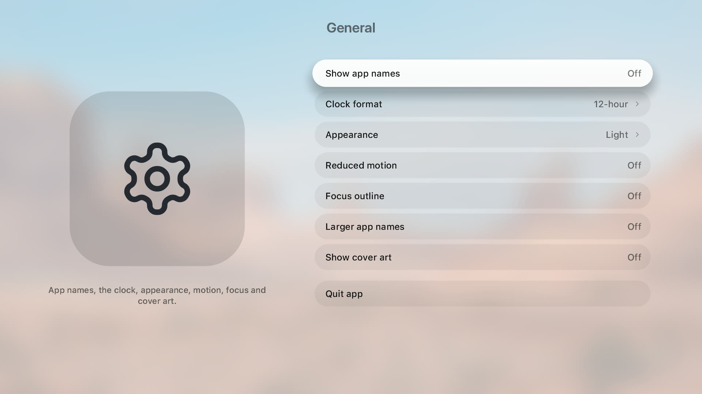

<div align="center">


# Lounge

**A tvOS-style home screen for LG TVs. Native, instant, and out of the way.**

[](https://github.com/YashwanthKamireddi/lounge/actions/workflows/ci.yml)
[](https://github.com/YashwanthKamireddi/lounge/releases/latest)
[](license)
[](#install)



</div>

## Why it feels different

Most LG home screens are web pages. Lounge is a native Rust + OpenGL ES program, drawn straight to
the TV's graphics plane. Measured on an LG 65UQ801C0SB:

|                               |                                                    |
| ----------------------------- | -------------------------------------------------- |
| **Cold start**                | first frame in ~0.7 s                              |
| **Home from an app**          | back in ~0.1 s                                     |
| **Behind YouTube or Netflix** | draws nothing, keeps ~16 MB: the app gets the TV   |
| **Every frame**               | repaints only what changed, one pass for all glass |

It is the TV's real Home: power-on, the Home button and Back all land on Lounge, the way they would
on LG's own. Every app wears its tvOS card, shipped in the package and on screen from the first
frame.

<table>
  <tr>
    <td width="50%"></td>
    <td width="50%"></td>
  </tr>
  <tr>
    <td width="50%"></td>
    <td width="50%"></td>
  </tr>
</table>

Glass dock and grid · Search and Inputs above the dock (Up reaches them) · app switcher · hold OK
to move, hide or uninstall · Light, Dark or Automatic · nine wallpapers · cover art · weather ·
focus outline and larger names for anyone who needs them.

## Install

Needs an LG TV rooted with an elevated [Homebrew Channel](https://www.webosbrew.org/).

1. In Homebrew Channel › Settings › Extra repositories, add
   `https://github.com/YashwanthKamireddi/lounge/releases/latest/download/repo.json`.
2. Install **Lounge** from Homebrew Channel. Updates arrive there too.
3. In Lounge, turn on **Settings › General › Lounge as Home**.

Or install `io.github.yashwanthkamireddi.lounge_1.1.0_arm.ipk` from
[Releases](https://github.com/YashwanthKamireddi/lounge/releases/latest) with
[webOS Dev Manager](https://github.com/webosbrew/dev-manager-desktop).

**Back to LG's Home** any time: turn the switch off, or over SSH as root run
`sh /var/lib/lounge/home.sh disable`. Lounge as Home is a bind mount over LG's Home executable,
held in memory and put back at boot by one Homebrew Channel hook; nothing writes to LG's firmware.
If it ever fails to start three times in a minute, it hands Home back to LG by itself.

## Make it yours

- **Profile picture:** copy JPEG or PNG files into
  `/media/developer/io.github.yashwanthkamireddi.lounge/avatars/` (owned by that folder's user)
  and pick one in Settings › General.
- **App cards and cover art:** `assets/tiles/<app id>.png` and `assets/heroes/<app id>.jpg`;
  files of the same name in `local/tiles/` or `local/heroes/` override them in your own build.

## Build

```sh
nix develop
pnpm install --frozen-lockfile
pnpm sdk
export WEBOS_NDK="$PWD/.build/toolchain/arm-webos-linux-gnueabi_sdk-buildroot"
pnpm run package   # dist/io.github.yashwanthkamireddi.lounge_1.1.0_arm.ipk
pnpm dev           # desktop preview with sample apps
```

[development.md](development.md) covers the architecture, tests, diagnostics and releases.

## Privacy and risk

No telemetry. Settings stay in local files on the TV; the only network requests are weather
(Open-Meteo, OpenStreetMap). Lounge runs on rooted TVs: every change it makes can be undone, but
rooting is your call, and Lounge comes without warranty (see the [license](license)).

## Credits

A fork of [lg-luma](https://github.com/ecklf/lg-luma) by ecklf and contributors (MIT, notice kept in
[license](license)). Not affiliated with LG, Apple or any app brand shown.
