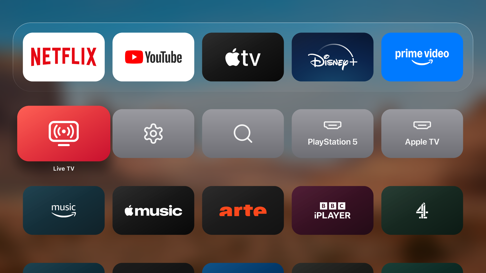
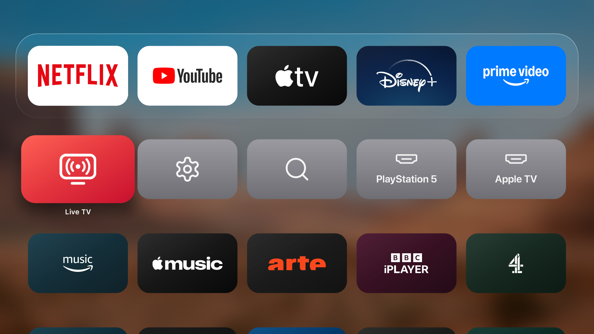
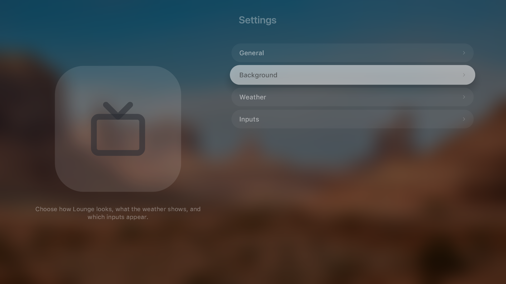
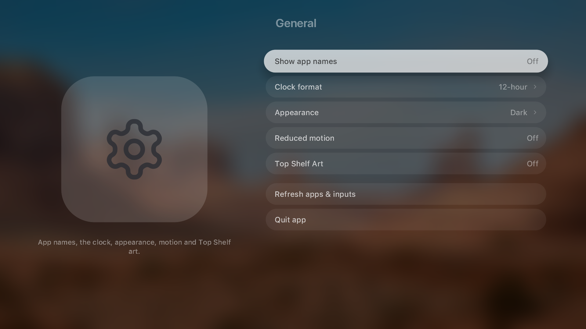

<p align="center"></p>

# Lounge

A calm, tvOS-style home screen for rooted LG webOS TVs. Native Rust and OpenGL ES, not a web
page: on a fresh TV it starts in about half a second, draws only what changed, and keeps out of
the way of the apps you watch.

> [!NOTE]
> Built and verified on an **LG 65UQ801C0SB** running **webOS 7.6**. Lounge started as a fork of
> [lg-luma](https://github.com/ecklf/lg-luma), which reports webOS 6 and newer; Lounge's own
> changes (power-on, Home key, memory behind apps) are tested on webOS 7.6 only.

<table>
  <tr>
    <td width="50%" align="center"></td>
    <td width="50%" align="center"></td>
  </tr>
  <tr>
    <td width="50%" align="center"></td>
    <td width="50%" align="center"></td>
  </tr>
</table>

## What it does

- A tvOS home: a glass dock of favourites, Top Shelf art, an app grid with HDMI inputs, and an
  app switcher.
- Turns on into Lounge: power-on and the remote's Home key land on it, with no LG Home in between.
- Light, Dark or Automatic appearance, wallpapers, a profile picture, hidden apps, weather.
- Light on the TV: behind a playing app it gives memory back and draws nothing.

## Installation

Build the package (see [Development](#development)), then from your computer, replacing `TV_IP`:

```sh
scp -O dist/io.github.yashwanthkamireddi.lounge_2.1.0_arm.ipk root@TV_IP:/tmp/lounge.ipk
ssh root@TV_IP
```

In the TV's root shell:

```sh
luna-send -i luna://com.webos.appInstallService/dev/install \
  '{"id":"io.github.yashwanthkamireddi.lounge","ipkUrl":"/tmp/lounge.ipk","subscribe":true}'
```

## Making Lounge the Home app

Lounge replaces LG Home through webOS's own mechanisms: nothing runs at boot and nothing is
mounted over LG's files. Verified on webOS 7.6 (UQ80); each step is one setting and undoes
cleanly. Run in the TV's root SSH shell.

**Back out of an app opens Lounge.** webOS opens the app registered as the default Home. On
webOS 7 the setting does not exist until written:

```sh
luna-send -n 1 luna://com.webos.settingsservice/setSystemSettings \
  '{"category":"general","settings":{"defaultApps":{"home":"io.github.yashwanthkamireddi.lounge"}}}'
```

Leaving an app then shows Lounge directly, without LG Home in between. To undo, set
`defaultApps` back to `{}`.

**The Home button opens Lounge.** The remote's Home key is handled by the compositor's key-filter
chain (configd `com.webos.surfacemanager.keyFilters`), loaded at boot. A filter that maps Home to
`io.github.yashwanthkamireddi.lounge`, such as [Glasshouse](https://github.com/rorygallagher2024/glasshouse)'s remote
keys, sends every press straight to Lounge.

**Lounge stays resident, LG Home does not.** LG's memory manager (`memchute`) reads
`/home/root/memorymanager-conf.json` before its built-in `/etc/palm` copy. Adding
`io.github.yashwanthkamireddi.lounge` to `KeepOnLaunchEx`, and taking `com.webos.app.home` out of it, keeps Lounge
loaded behind apps while LG Home is freed when an app opens. Takes effect after a restart; keep a
copy of the original file to undo.

## Development

### Setup & Building

From the repository root, with Nix flakes enabled:

```sh
nix develop
pnpm install --frozen-lockfile
pnpm sdk
export WEBOS_NDK="$PWD/.build/toolchain/arm-webos-linux-gnueabi_sdk-buildroot"
pnpm run package
```

The first native runtime preparation also downloads a
checksum-pinned SDL-webOS library; both downloads are cached under `.build/`.

Output:

```text
dist/io.github.yashwanthkamireddi.lounge_2.1.0_arm.ipk
dist/sha256sums
dist/repo.json
dist/app-icon-large.png
```

Open [webOS Dev Manager](https://github.com/webosbrew/dev-manager-desktop), connect to the TV's
IP on port **22** as **root**, and install the IPK. Open **Lounge** from the TV menu. Homebrew
Channel must be elevated.

Wait for installation success; Ctrl+C closes an ongoing subscription. Fully close and reopen
Lounge after updating. The [development guide](development.md#tv-startup-diagnostics) has a jailed
launch command that exposes errors hidden by the normal menu launch.

## Preview

```sh
nix develop
pnpm install --frozen-lockfile
pnpm assets
pnpm dev
```

The desktop preview uses sample inventory and never calls TV services. To manually exercise a
longer app grid:

```sh
pnpm dev --test-extra-apps 120
```

Preview preferences are separate from normal preferences. See [development.md](development.md)
for controls, vector rendering, diagnostics, tests and the source layout.

For release-worthy changes, include a file generated by `pnpm changeset` in your PR. The automated
Version Packages PR synchronizes app versions and publishes after merging and passing CI.
See [Releases](development.md#releases) for the workflow and repository setup.

## Privacy and scope

App/input discovery uses fixed inventory commands through Homebrew Channel's elevated service.
App launches use the native Luna bus with declared permissions. There is no demo inventory
fallback on the TV. Native caller permissions and lifecycle behavior can differ by firmware.

Favorites, hidden apps, settings, weather location and cached readings stay in local JSON files
in an app-owned persistent directory outside the installed payload.
Weather search/forecast requests go to Open-Meteo, with embedded TLS roots and bounded responses.
There is no browser geolocation, IP-based location lookup, telemetry or runtime font download.

## Credits

Lounge is a fork of [lg-luma](https://github.com/ecklf/lg-luma) by ecklf and its contributors,
under the MIT licence; their copyright notice is kept in [license](license).

Lounge is not affiliated with LG, Apple or any app brand shown in its UI. MIT licensed.
